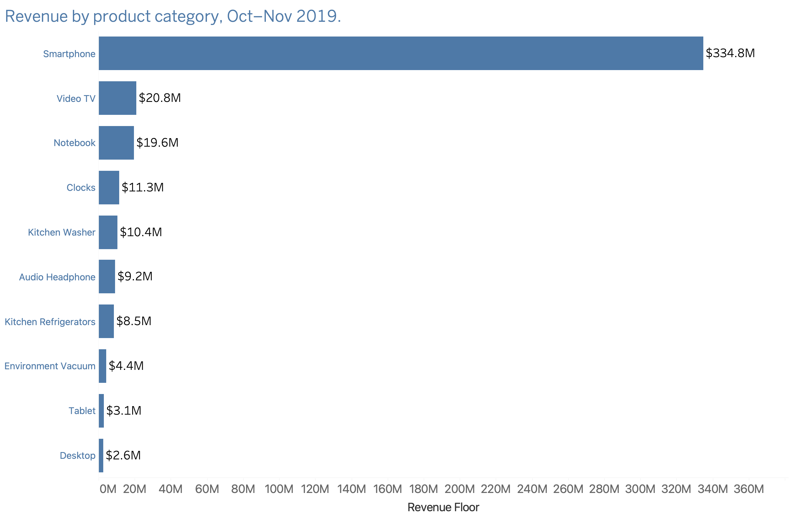

# 🛒 E-Commerce Product Engagement & Conversion Analysis

## 📊 Project Overview
This project turns **[N] million raw clickstream events** (Oct–Nov 2019) into a compact, category-level reporting table in PostgreSQL, then visualizes it in Tableau. Moving the cleaning and aggregation upstream into SQL keeps the dashboard fast and the logic reproducible.

| 📌 At a glance | |
|---|---|
| Source data | Kaggle eCommerce Behavior Data (multi-category store) |
| Raw events | [N] million rows |
| Summary table | 7,625 rows (day × product category) |
| Row reduction | >99.9% |
| Period | Oct 1 – Nov 30, 2019 |

## 🛠️ Tech Stack & Architecture
* **Database Engine:** PostgreSQL 15 (installed via Homebrew)
* **Database IDE:** DBeaver Community Edition
* **Data Visualization:** Tableau Public
* **SQL Techniques:** `SPLIT_PART()`, `INITCAP()`, `REPLACE()`, `CASE WHEN` conditional aggregation, `GROUP BY`/`HAVING` [add CTEs / window functions only if used in your script]

```
Kaggle CSVs  →  raw_events  →  product_performance_summary  →  Tableau
 (Oct, Nov)     (PostgreSQL)     (day × category, cleaned)      (charts)
```

## 📐 Data Transformation & Optimization
Raw category values are dot-separated paths (e.g. `furniture.universal.light`). Parsing millions of these inside Tableau caused rendering lag, so the work moved into SQL:

1. **🧹 Upstream string cleaning:** Used `SPLIT_PART()`, `INITCAP()` and `REPLACE()` to convert paths into readable labels (`Universal Light`) inside the database.
2. **🔁 Session-level aggregation:** Counted sessions per day and category that reached `view`, `cart` and `purchase` [describe your exact method, e.g. conditional aggregation].
3. **⚡ Pre-aggregation:** Collapsed [N] million events into a **7,625-row** summary table, so Tableau reads a small table instead of scanning raw logs.

## 📈 Key Findings

### 💰 Smartphones dominate revenue
Smartphones account for about **[88]%** of top-10 category revenue ($334.9M of $[381]M).




## 💡 Recommendation (a hypothesis to test)
Cart abandonment is the largest loss in the funnel, so a **cart-reminder A/B test** is a sensible next step.
*Illustrative sizing:* recovering 2% of abandoned carts at an average order value of $[X] is about $[Y]. This is a scenario, not a forecast.

## 🚧 Assumptions & Limitations
* Two months of data only: no seasonality and no true lifetime value.
* No order ID, so orders are approximated by purchase sessions.
* A session that touches several categories is counted in each, so category totals overlap.
* Sessions with no category were excluded.

## ▶️ How to Reproduce
1. Download the two CSV files from Kaggle.
2. Create the database and load them into `raw_events`.
3. Run `transform_and_aggregate.sql` to build `product_performance_summary`.
4. Connect Tableau to the summary table.

## 🔗 Deliverables
* [SQL Transformation Script](transform_and_aggregate.sql)
* Dashboard screenshots in the `images/` folder
* Data source: [Kaggle eCommerce Behavior Data](https://www.kaggle.com/datasets/mkechinov/ecommerce-behavior-data-from-multi-category-store)
